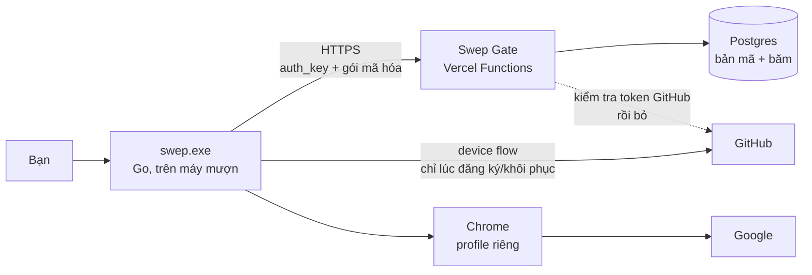
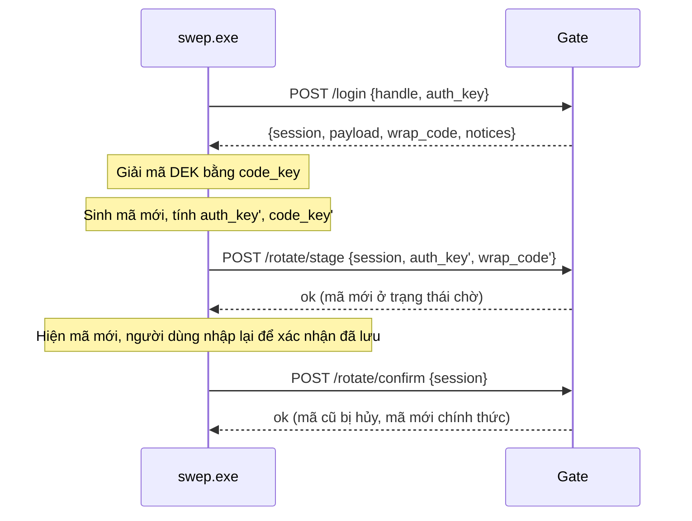

# Swep

> **Chạy một lệnh trên máy mượn → nhập mã cá nhân → có ngay Chrome đã đăng nhập Google của bạn. Xong việc → dọn sạch, nhận mã mới.**

**Trạng thái:** 🟡 Giai đoạn thiết kế, chưa có code.
**Phạm vi v1:** chỉ Chrome profile + đăng nhập Google. Docker, IDE, database, project runner nằm ở [Tầm nhìn dài hạn](#16-tầm-nhìn-dài-hạn-ngoài-phạm-vi-v1).

Quy ước: những chỗ đánh dấu **[cần xác minh]** là giả định chưa được kiểm chứng. Giai đoạn 0 (spike) tồn tại để kiểm chứng chúng trước khi đầu tư vào phần còn lại.

---

## Mục lục

1. [Mục tiêu và phi mục tiêu](#1-mục-tiêu-và-phi-mục-tiêu)
2. [Trải nghiệm người dùng](#2-trải-nghiệm-người-dùng)
3. [Quyết định thiết kế đã chốt](#3-quyết-định-thiết-kế-đã-chốt)
4. [Kiến trúc](#4-kiến-trúc)
5. [Mật mã](#5-mật-mã)
6. [Xoay mã và xử lý lệch](#6-xoay-mã-và-xử-lý-lệch)
7. [Swep Gate: API và dữ liệu](#7-swep-gate-api-và-dữ-liệu)
8. [Client: Chrome, Google và dọn dẹp](#8-client-chrome-google-và-dọn-dẹp)
9. [Mô hình bảo mật](#9-mô-hình-bảo-mật)
10. [Cấu trúc repo](#10-cấu-trúc-repo)
11. [Kế hoạch triển khai theo giai đoạn](#11-kế-hoạch-triển-khai-theo-giai-đoạn)
12. [Kiểm thử](#12-kiểm-thử)
13. [CI/CD và phát hành](#13-cicd-và-phát-hành)
14. [Rủi ro](#14-rủi-ro)
15. [Câu hỏi còn mở](#15-câu-hỏi-còn-mở)
16. [Tầm nhìn dài hạn (ngoài phạm vi v1)](#16-tầm-nhìn-dài-hạn-ngoài-phạm-vi-v1)
17. [Giấy phép và miễn trừ trách nhiệm](#17-giấy-phép-và-miễn-trừ-trách-nhiệm)

---

## 1. Mục tiêu và phi mục tiêu

### Mục tiêu v1

| # | Mục tiêu | Tiêu chí kiểm tra |
|---|---|---|
| G1 | Một lệnh để bắt đầu | Một dòng PowerShell tải và chạy Swep |
| G2 | Đăng nhập bằng một mã duy nhất, **không cần điện thoại** | Nhập `username-XXX-XXX` là vào được |
| G3 | Mã đổi sau mỗi lần dùng | Mỗi lần đăng nhập thành công cấp mã mới; mã cũ hết hiệu lực sau khi xác nhận |
| G4 | Chrome profile riêng, đã đăng nhập Google | Mở Chrome là dùng được tài khoản, không bị hỏi xác minh thêm (xem Spike A) |
| G5 | Dọn sạch khi xong | Snapshot trước/sau `down` không còn gì do Swep tạo |
| G6 | Server không đọc được bí mật của người dùng | Kẻ chỉ có database không giải mã được gì |

### Phi mục tiêu v1

- Docker/WSL2, database, cấu hình IDE, clone project (xem mục 16)
- Hỗ trợ macOS/Linux (chỉ Windows 10/11)
- Nhiều người dùng chung một dịch vụ công cộng. Mỗi người tự deploy Gate của mình, hoặc chỉ mình tác giả dùng ở giai đoạn đầu
- Chống lại máy mượn đã nhiễm keylogger/malware (không công cụ nào làm được)
- Xóa dữ liệu ở mức pháp y

## 2. Trải nghiệm người dùng

### Đăng ký (một lần, trên thiết bị tin cậy của bạn, có điện thoại)

```text
> swep register
Đăng nhập GitHub: mở github.com/login/device, nhập mã  WDJB-MJHT
✔ Xác nhận bạn là: nhatprx

Tài khoản Google (nên là tài khoản riêng cho công việc): ****@gmail.com
Mật khẩu: ********
Khóa 2FA (chuỗi base32 khi cài ứng dụng xác thực): ********

═══════════════════════════════════════════════
 MÃ ĐĂNG NHẬP:   nhatprx-7K2-QX9
 KHÓA KHÔI PHỤC: 4F8Q-... (dài, cất ở nơi an toàn)
═══════════════════════════════════════════════
Hãy lưu cả hai. Khóa khôi phục sẽ KHÔNG hiện lại.
```

### Dùng trên máy mượn

```text
> irm https://raw.githubusercontent.com/<owner>/swep/<tag>/install.ps1 | iex
> swep

Nhập mã: nhatprx-7K2-QX9
✔ Xác thực xong
✔ Mã MỚI của bạn: nhatprx-M3R-8TV   ← lưu lại ngay
Nhập lại mã mới để xác nhận đã lưu: nhatprx-M3R-8TV
✔ Đã đổi mã. Mã cũ hết hiệu lực.

ℹ Từ lần đăng nhập trước có 0 lần nhập sai mã.
✔ Đang mở Chrome và đăng nhập Google...
✔ Sẵn sàng.
```

### Kết thúc

```text
> swep down
✔ Đóng Chrome (chỉ tiến trình dùng profile của Swep)
✔ Xóa profile Chrome, trạng thái, log
✔ Gỡ Chrome (vì Swep là bên cài)
⚠ Việc cần làm tay: vào myaccount.google.com/device-activity và đăng xuất thiết bị này
✔ Hoàn tất. Báo cáo: so sánh với snapshot ban đầu, không còn dấu vết.
```

### Các lệnh

| Lệnh | Mô tả |
|---|---|
| `swep` hoặc `swep up` | Đăng nhập bằng mã, xoay mã, mở Chrome |
| `swep down` | Dọn sạch |
| `swep register` | Đăng ký lần đầu (thiết bị tin cậy) |
| `swep recover` | Khôi phục khi mất mã (khóa khôi phục + GitHub) |
| `swep revoke` | Kill switch: vô hiệu hóa mã hiện tại |
| `swep doctor` | Kiểm tra điều kiện máy, không thay đổi gì |
| `--WhatIf` / `--dry-run` | Cờ chung: chỉ in ra việc sẽ làm |

## 3. Quyết định thiết kế đã chốt

| Chủ đề | Quyết định | Lý do |
|---|---|---|
| Danh tính | Mã `username-XXX-XXX` (6 ký tự xoay vòng) | Không cần điện thoại hay mật khẩu trên máy mượn |
| Server | **Có** (Swep Gate trên Vercel) | Mã 6 ký tự quá ngắn: chống đoán mã cần bên đếm số lần thử và khóa, GitHub không làm được |
| GitHub | Chỉ dùng **khi đăng ký/khôi phục** (device flow) để chứng minh sở hữu username | Chống người lạ đăng ký trước tên của bạn |
| Mã hóa | **Phía client**; server không bao giờ thấy mã, khóa hay bí mật | Server bị lộ không kéo theo lộ tài khoản Google |
| Yếu tố thứ hai Google | Lưu khóa TOTP trong gói mã hóa, **client tự tính mã 6 số** | Không cần điện thoại; tính ở client để server không biết khóa |
| Tài khoản Google | **Tài khoản riêng cho công việc**, không dùng tài khoản chính | Gói chứa cả mật khẩu và yếu tố thứ hai của tài khoản |
| Ngôn ngữ client | **Go**, một file `swep.exe` | PowerShell 5.1 thiếu argon2/AEAD hiện đại; Go đóng gói đơn giản |
| Bootstrap | `install.ps1` chỉ tải `swep.exe` đã ghim tag + kiểm tra checksum | Giảm bề mặt tấn công của `irm \| iex` |
| Xoay mã | Cấp mã mới **ngay lúc đăng nhập**, bắt nhập lại để xác nhận | An toàn khi máy sập giữa chừng (khác ý ban đầu là cấp lúc logout, xem mục 6) |

## 4. Kiến trúc



**Ai biết gì:**

| Thành phần | Biết | Không biết |
|---|---|---|
| Máy của bạn | Mã, mật khẩu Google, khóa TOTP (trong bộ nhớ) | |
| Gate/Database | Username GitHub, băm xác thực, bản mã | Mã, mật khẩu Google, khóa TOTP |
| GitHub | Bạn đã xác thực thiết bị trong lúc đăng ký | Nội dung gói |

## 5. Mật mã

> **Phần này cần nhất sự cẩn thận.** Không tự nghĩ ra thuật toán mới: chỉ ghép các primitive chuẩn (argon2id, HKDF, AEAD). Viết `docs/CRYPTO.md` và có test vector trước khi viết server.

### Mã đăng nhập

- Dạng: `<handle>-XXX-XXX`, trong đó `handle` là username GitHub (chữ thường, cố định từ lúc đăng ký) và 6 ký tự lấy từ bảng 32 ký tự Crockford base32 (không có `I`, `L`, `O`, `U`), tức **30 bit** entropy
- Chống nhầm khi gõ: bỏ qua gạch ngang, không phân biệt hoa/thường, tự chuẩn hóa `O→0`, `I/L→1`

### Dẫn xuất khóa (ở client)

```text
code      = 6 ký tự
seed      = Argon2id(password=code, salt=SHA256("swep/v1/" + handle), tuned ≈ 0.5–1 giây)
auth_key  = HKDF(seed, info="swep/auth")     # gửi lên server để chứng minh
code_key  = HKDF(seed, info="swep/wrap")     # KHÔNG BAO GIỜ rời máy
```

Hai khóa độc lập: biết `auth_key` không suy ra được `code_key`.

### Gói dữ liệu (payload) và khóa dữ liệu (DEK)

```text
DEK            = 32 byte ngẫu nhiên, sinh một lần lúc đăng ký
payload        = AEAD(DEK, { google_email, google_password, totp_secret, backup_codes?, … })
wrap_code      = AEAD(code_key, DEK)           # mở bằng mã đăng nhập
wrap_recovery  = AEAD(recovery_key, DEK)       # mở bằng khóa khôi phục
```

Thiết kế DEK giúp: **xoay mã chỉ cần bọc lại DEK** (nhỏ, nhanh), không phải mã hóa lại toàn bộ payload; và có đường khôi phục độc lập với mã.

- AEAD: XChaCha20-Poly1305 hoặc AES-256-GCM, nonce ngẫu nhiên, ràng buộc `handle` + phiên bản vào dữ liệu đi kèm (associated data)
- `recovery_key`: 128 bit ngẫu nhiên, hiển thị một lần, định dạng nhóm 4 ký tự

### Phía server (phòng thủ chiều sâu)

Vì chỉ 30 bit, mã không tự bảo vệ nổi trước tấn công offline. Lớp bảo vệ thật nằm ở server:

```text
auth_hash      = HMAC-SHA256(PEPPER, auth_key)                # lưu để so khớp, so sánh thời gian hằng số
stored_blob    = AEAD(SERVER_KEY, payload ‖ wrap_code ‖ wrap_recovery)   # bọc thêm một lớp (envelope)
```

- `PEPPER` và `SERVER_KEY` là hai bí mật **tách biệt**, nằm ở biến môi trường của Vercel (hoặc KMS), không nằm trong database
- Kẻ chỉ lấy được database: không thể thử đoán offline (thiếu `PEPPER`), cũng không đọc được blob (thiếu `SERVER_KEY`)
- Kẻ chiếm **toàn bộ** server (database + hai bí mật) vẫn có thể dò mã của **từng người** offline: ≈ 2³⁰ lần thử × chi phí argon2. Đây là giới hạn của mã ngắn, được ghi nhận trong [mục 9](#9-mô-hình-bảo-mật) và là lý do có tùy chọn tăng độ dài mã sau này

### Việc cấm

- Không tự cài đặt thuật toán mã hóa; dùng thư viện chuẩn (`golang.org/x/crypto`, thư viện `crypto/*` của Go)
- Không ghi mã, khóa, mật khẩu ra đĩa hay log
- Không dùng chung khóa giữa các mục đích (đã tách bằng HKDF `info`)

## 6. Xoay mã và xử lý lệch



| Tình huống | Hành vi |
|---|---|
| Đăng nhập thành công | Mã mới ở trạng thái **chờ**; **mã cũ vẫn dùng được** |
| Người dùng nhập lại đúng mã mới | `confirm`: mã mới chính thức, mã cũ bị hủy |
| Máy sập/mất mạng trước khi confirm | Mã cũ vẫn dùng được, mã chờ bị bỏ; không mất quyền truy cập |
| Confirm gửi đi nhưng phản hồi bị mất | `confirm` idempotent: gọi lại cùng `session` cho kết quả như nhau |
| Hai máy đăng nhập cùng lúc | Mã chờ của phiên sau ghi đè phiên trước; mã đang hoạt động không đổi cho tới khi một phiên confirm |
| Nghi ngờ mã bị lộ (đăng nhập ra "mã sai") | Mã đã bị người khác dùng trước: chạy `swep recover` rồi `swep revoke` |
| Mất cả mã | `swep recover`: khóa khôi phục + xác minh GitHub lại |

**Vì sao khác ý ban đầu ("cấp mã mới khi logout")?** Nếu mã chỉ đổi lúc logout mà máy sập, hoặc bạn quên bấm logout, mã cũ đã bị tiêu mà không có mã mới, tức là khóa chính mình. Cấp mã mới ngay lúc đăng nhập, rồi bắt nhập lại để xác nhận đã lưu, giữ được hiệu quả "mã dùng một lần" mà không tạo điểm chết này.

## 7. Swep Gate: API và dữ liệu

### Endpoint

| Endpoint | Xác thực bằng | Việc |
|---|---|---|
| `POST /api/register` | Token GitHub (device flow) | Tạo người dùng: `auth_hash`, `stored_blob`, `recovery_auth_hash`. Gate gọi API GitHub để lấy `id` và `login`, kiểm tra `handle == login`, **rồi bỏ token, không lưu** |
| `POST /api/login` | `handle` + `auth_key` | Trả `session`, `payload`, `wrap_code`, thông báo (số lần sai kể từ lần trước, thời điểm đăng nhập trước) |
| `POST /api/rotate/stage` | `session` | Lưu `auth_hash'` và `wrap_code'` ở trạng thái chờ |
| `POST /api/rotate/confirm` | `session` | Thăng cấp mã chờ thành mã chính thức |
| `POST /api/payload` | `session` | Cập nhật payload (ví dụ đã dùng một mã dự phòng Google) |
| `POST /api/recover` | Token GitHub + `recovery_auth` | Trả `wrap_recovery` và `payload` |
| `POST /api/recover/finish` | Token GitHub + `recovery_auth` | Đặt mã mới (và khóa khôi phục mới nếu muốn) |
| `POST /api/revoke` | Token GitHub | Vô hiệu hóa mọi mã; bắt buộc khôi phục để dùng lại |

### Bảng dữ liệu

`users`

| Cột | Ghi chú |
|---|---|
| `github_id` (PK) | ID số, ổn định kể cả khi đổi username |
| `handle` (unique) | Username lúc đăng ký, dùng làm tiền tố mã |
| `auth_hash` | HMAC của `auth_key` |
| `pending_auth_hash`, `pending_wrap_code`, `pending_at` | Mã chờ xác nhận, tự hết hạn |
| `stored_blob` | Bản mã đã bọc hai lớp |
| `recovery_auth_hash` | Dùng khi khôi phục |
| `failed_count`, `locked_until` | Chống dò mã |
| `failed_since_last_login` | Hiển thị cảnh báo lần đăng nhập sau |
| `last_login_at`, `created_at`, `revoked_at` | |

`sessions`: `id` (băm), `github_id`, `expires_at` (ngắn, ~10 phút), `used_for_confirm`.
`audit_log`: thời điểm, `github_id` hoặc handle thử, IP đã băm, kết quả. Không ghi bất kỳ giá trị bí mật nào.

### Chống dò mã (rate limiting)

- Mọi kết quả sai (handle không tồn tại, mã sai, tài khoản bị khóa) trả **cùng một phản hồi** và cùng độ trễ, để không dò được ai có tài khoản
- Giới hạn theo IP và theo handle, khóa **tăng dần theo cấp số nhân** (không bao giờ khóa vĩnh viễn: nếu khóa vĩnh viễn, ai cũng khóa được tài khoản của bạn bằng cách cố tình nhập sai)
- Cảnh báo hiển thị ở lần đăng nhập sau thành công (không cần email ở v1)
- Chi tiết ngưỡng cần chốt ở `docs/SPEC.md` (xem mục 15)

### Hạ tầng

- Vercel Functions (TypeScript) + Postgres (ví dụ Neon qua Vercel Marketplace) **[cần xác minh]** điều khoản của gói miễn phí đối với việc dùng cá nhân
- Biến môi trường: `PEPPER`, `SERVER_KEY`, `GITHUB_CLIENT_ID`, `DATABASE_URL`
- Sao lưu database định kỳ và quy trình khôi phục (mất database = mất mọi mã; người dùng phải đăng ký lại)

## 8. Client: Chrome, Google và dọn dẹp

### Thư mục làm việc

Mọi thứ Swep tạo ra nằm trong **một thư mục gốc** để dọn một lần:

```text
<root>/                       # mặc định %LOCALAPPDATA%\Swep, đổi được bằng --root
├── chrome-profile/           # --user-data-dir của Chrome
├── state/
│   ├── snapshot.before.json  # trạng thái máy trước khi làm gì
│   └── ledger.json           # sổ ghi những gì Swep đã tạo
└── logs/                     # không chứa bí mật
```

### Mở Chrome

```text
chrome.exe --user-data-dir="<root>\chrome-profile" --no-first-run --no-default-browser-check
```

- Nếu chưa có Chrome, cài bằng `winget` (ghi vào ledger với `preexisting:false` để `down` biết có thể gỡ). **[cần xác minh]** có cài được không cần quyền admin không
- Chrome Sync: sau khi đăng nhập Google, cần bật đồng bộ trong Chrome. **[cần xác minh]** bước này có làm tự động được không hay cần một thao tác của người dùng

### Đăng nhập Google: ba phương án (chốt bằng Spike A)

| # | Phương án | Ưu | Nhược |
|---|---|---|---|
| 1 | **Hỗ trợ bằng clipboard:** hiện mật khẩu và mã TOTP, đưa vào clipboard, tự xóa sau ~20 giây | Ổn định, ít vỡ, gần với thao tác người dùng thật | Mất vài giây thao tác tay |
| 2 | **Giả lập gõ phím** (SendInput) vào cửa sổ Chrome thật | Tự động, giống người dùng thật | Dễ vỡ khi giao diện Google đổi |
| 3 | **Điều khiển bằng Chrome DevTools Protocol** | Tự động, đáng tin cậy về mặt kỹ thuật | Google có thể phát hiện và chặn trình duyệt bị điều khiển |

Quy tắc chung: clipboard phải loại khỏi **lịch sử clipboard** và **đồng bộ clipboard đám mây** của Windows (đăng ký các định dạng loại trừ tương ứng), và tự xóa sau thời gian ngắn. Ưu tiên phương án giống thao tác người dùng thật; **[cần xác minh]** các điều khoản của Google về đăng nhập tự động.

### TOTP

Tính ở client theo RFC 6238 (HMAC-SHA1, bước 30 giây, 6 chữ số), tương thích Google Authenticator. Khóa lấy từ bước thiết lập 2FA của Google ("không quét được mã?"), sau đó vẫn dùng song song với điện thoại.

### `down` (dọn sạch)

Thứ tự cố định:

1. Đóng Chrome: **chỉ** tiến trình đang dùng profile của Swep (kiểm tra qua đối số `--user-data-dir`), tuyệt đối không đóng Chrome của chủ máy
2. Xóa clipboard nếu còn nội dung của Swep
3. Xóa `chrome-profile` (thử lại khi file bị khóa)
4. Gỡ Chrome **chỉ khi** ledger ghi Swep là bên đã cài
5. Xóa `state/`, `logs/`, rồi thư mục gốc
6. Chụp snapshot sau, so với snapshot trước, in báo cáo
7. Nhắc việc phải làm tay: **đăng xuất thiết bị này** tại trang hoạt động thiết bị của Google, vì Swep không đăng xuất từ xa phiên Google được

Quy tắc bất di bất dịch: chỉ gỡ cái có trong ledger với `preexisting:false`; `--dry-run` in ra đúng danh sách sẽ xóa.

## 9. Mô hình bảo mật

| # | Kịch bản tấn công | Mức độ | Biện pháp / chấp nhận |
|---|---|---|---|
| T1 | Người lạ đoán mã qua mạng | Thấp | 30 bit + giới hạn tần suất + khóa tăng dần + phản hồi giống nhau cho mọi lỗi |
| T2 | Lộ riêng database | Thấp | Thiếu `PEPPER` (không dò offline được) và `SERVER_KEY` (không đọc được blob) |
| T3 | Chiếm toàn bộ server (database + bí mật) | **Trung bình** | Có thể dò từng người offline (≈ 2³⁰ × chi phí argon2). **Rủi ro được chấp nhận ở v1**; giảm thiểu bằng argon2 nặng, tùy chọn mã dài hơn, tài khoản Google riêng, cảnh báo và kill switch |
| T4 | Lộ mã (nhìn trộm, ghi chú bị lộ) | Trung bình | Mã dùng một lần; người dùng hợp lệ đăng nhập trước sẽ làm mã đó vô hiệu và nhận ra bất thường khi mã cũ báo sai |
| T5 | Máy mượn có keylogger/malware | **Cao, ngoài phạm vi** | Không cứu được mật khẩu Google bị lộ. Giảm thiểu: tài khoản riêng, bật cảnh báo đăng nhập của Google, đổi mật khẩu sau khi dùng trên máy lạ |
| T6 | `install.ps1` hoặc `swep.exe` bị thay | Cao | Ghim tag/commit, checksum, review bắt buộc, release có chữ ký, build tái lập |
| T7 | Quên `down` hoặc máy sập: profile Chrome còn đăng nhập | Trung bình | Báo cáo rõ; nhắc đăng xuất thiết bị; lệnh `swep down` chạy lại được |
| T8 | Gate hoặc Vercel ngừng hoạt động | Trung bình | Không đăng nhập được. v1 chấp nhận (không có đường dự phòng offline) |
| T9 | Dùng nhầm tài khoản Google chính | Trung bình | README, wizard đăng ký đều cảnh báo; khuyến nghị tài khoản riêng |
| T10 | Google khóa tài khoản vì đăng nhập "đáng ngờ" | Trung bình | Dùng tài khoản riêng, có phương án khôi phục tài khoản Google ngoài Swep |

Nguyên tắc vận hành:

- Bí mật chỉ nằm trong bộ nhớ khi có thể, không bao giờ ghi log
- `SECURITY.md` có kênh báo lỗ hổng riêng trước khi mở public
- Quét bí mật (gitleaks) trên mọi commit từ ngày đầu; không commit key vào repo ngay cả repo private

## 10. Cấu trúc repo

Monorepo `swep` (private cho tới hết giai đoạn 6):

```text
swep/
├── client/                       # Go
│   ├── cmd/swep/main.go
│   └── internal/
│       ├── crypto/               # argon2id, HKDF, AEAD, TOTP
│       ├── gate/                 # client gọi API Gate
│       ├── github/               # device flow
│       ├── chrome/               # tìm/cài/mở Chrome, đăng nhập Google
│       ├── cleanup/              # snapshot, ledger, down
│       └── ui/                   # nhắc người dùng, nhập mã, xác nhận
├── gate/                         # Vercel (TypeScript)
│   ├── api/                      # endpoint
│   ├── lib/                      # mật mã phía server, rate limit
│   └── migrations/
├── install/
│   └── install.ps1               # bootstrap: tải, kiểm checksum, chạy
├── docs/
│   ├── SPEC.md                   # giao thức chi tiết
│   ├── CRYPTO.md                 # thuật toán, tham số, test vector
│   ├── THREAT-MODEL.md
│   └── RUNBOOK.md                # sự cố: lộ bí mật server, mất database
├── .github/workflows/
├── SECURITY.md
├── LICENSE
└── README.md
```

## 11. Kế hoạch triển khai theo giai đoạn

Ước lượng công sức: **S** (vài ngày), **M** (khoảng một tuần), **L** (hơn một tuần). Mỗi giai đoạn có tiêu chí hoàn thành kiểm tra được; chỉ sang giai đoạn sau khi đạt.

### Giai đoạn 0: Spike và Spec (M)

Mục tiêu: trả lời những câu hỏi có thể làm sập cả dự án **trước khi** viết Gate.

**Spike A: đăng nhập Google tự động (quan trọng nhất)**
- Máy ảo Windows 11 sạch, Chrome với profile mới, **tài khoản Google thử** (không dùng tài khoản thật), bật 2FA bằng ứng dụng xác thực
- Thử ba phương án ở mục 8, mỗi phương án 10 lần, ở nhiều điều kiện mạng (NAT của VM, hotspot điện thoại, VPN)
- Ghi lại: tỉ lệ thành công, có bị yêu cầu xác minh thêm không, có cảnh báo đăng nhập lạ không, tài khoản có bị khóa tạm không
- **Quy tắc quyết định:** phương án tự động nào đạt ≥ 9/10 và không bị xác minh thêm thì chọn; nếu không, chọn phương án 1 (clipboard)
- Sản phẩm: ghi chú kết quả trong `docs/SPIKE-A.md`

**Spike B: mật mã (trên máy bạn)**
- Prototype Go: dẫn xuất khóa, DEK, bọc/mở, TOTP; kiểm tra TOTP khớp ứng dụng xác thực thật
- Đo thời gian argon2id trên máy yếu để chọn tham số (mục tiêu ≈ 0.5–1 giây)
- Sản phẩm: `docs/CRYPTO.md` kèm test vector

**Spike C: Chrome + dọn dẹp**
- Mở Chrome với `--user-data-dir` riêng, đăng nhập, bật Sync, rồi xóa; so snapshot trước/sau để tìm dấu vết còn sót (registry, thư mục khác, Credential Manager)
- Kiểm tra: cài Chrome không cần admin được không; có đóng được đúng tiến trình Chrome của profile không

**Spec:** viết `docs/SPEC.md` (giao thức, mã lỗi, ngưỡng rate limit), `docs/THREAT-MODEL.md`, chốt các câu hỏi mở ở mục 15.

**Hoàn thành khi:** có quyết định bằng văn bản cho phương án đăng nhập Google và tham số mật mã; bạn đọc và đồng ý spec.

### Giai đoạn 1: Swep Gate (L)

- [ ] Dựng dự án Vercel, Postgres, migration, biến môi trường
- [ ] Triển khai `register`, `login`, `rotate/stage`, `rotate/confirm`, `payload`, `recover`, `recover/finish`, `revoke`
- [ ] Bọc blob bằng `SERVER_KEY`, băm bằng `PEPPER`, so sánh thời gian hằng số
- [ ] Rate limiting + khóa tăng dần + phản hồi đồng nhất
- [ ] Audit log, thông báo "số lần sai kể từ lần trước"
- [ ] Test tự động cho mọi nhánh (mã sai, hết hạn, hai phiên song song, confirm lặp lại)

**Hoàn thành khi:** bộ test pass; script mô phỏng tấn công dò mã bị chặn đúng ngưỡng; không có endpoint nào phân biệt được "handle không tồn tại" với "mã sai".

### Giai đoạn 2: Client lõi (L)

- [ ] `swep register`: device flow GitHub, nhập thông tin Google, sinh DEK/mã/khóa khôi phục, hiển thị một lần
- [ ] `swep` (đăng nhập): nhập mã, dẫn xuất khóa, gọi `login`, giải mã DEK, sinh mã mới, `stage` → bắt nhập lại → `confirm`
- [ ] `swep recover`, `swep revoke`
- [ ] Giữ bí mật trong bộ nhớ, không ghi đĩa, không log; xóa biến nhạy cảm khi xong (best effort)
- [ ] Xử lý lỗi mạng ở mọi bước, đảm bảo xoay mã an toàn khi bị ngắt giữa chừng

**Hoàn thành khi:** đăng ký trên máy A, đăng nhập thành công ở máy B rồi nhận mã mới; kịch bản giết tiến trình giữa lúc xoay mã không làm mất quyền truy cập.

### Giai đoạn 3: Chrome và đăng nhập Google (M)

- [ ] Tìm/cài Chrome, ghi ledger
- [ ] Mở Chrome với profile riêng
- [ ] Đăng nhập Google theo phương án đã chốt ở Spike A, tính TOTP ở client
- [ ] Xử lý bước bật Chrome Sync theo kết quả Spike C
- [ ] Clipboard loại khỏi lịch sử/đám mây nếu dùng phương án 1

**Hoàn thành khi:** từ máy ảo sạch, nhập mã là có Chrome đã đăng nhập, trong tối đa vài phút, 5 lần liên tiếp.

### Giai đoạn 4: `down` và dọn dẹp (M)

- [ ] Snapshot trước, ledger trong lúc chạy
- [ ] `down`: đóng đúng tiến trình, xóa profile, gỡ có điều kiện, báo cáo
- [ ] `--dry-run` in ra danh sách chính xác
- [ ] Chạy lại `down` an toàn khi lần trước dở dang

**Hoàn thành khi:** snapshot sau `down` trùng snapshot ban đầu; máy có sẵn Chrome (của chủ máy) **không** bị đóng hay gỡ.

### Giai đoạn 5: Bootstrap và phát hành (S–M)

- [ ] `install.ps1` tải `swep.exe` theo tag, kiểm checksum, cảnh báo rõ khi sai
- [ ] CI build, đóng gói, tạo checksum, phát hành
- [ ] Hướng dẫn chạy theo tag/commit cố định

**Hoàn thành khi:** trên máy ảo sạch, dòng lệnh duy nhất đưa tới màn hình nhập mã.

### Giai đoạn 6: Gia cố bảo mật (M)

- [ ] Rà soát mật mã (tốt nhất nhờ người có chuyên môn xem lại `CRYPTO.md`)
- [ ] Kiểm thử tấn công: dò mã, enumeration qua thời gian phản hồi, replay session, race condition khi xoay mã
- [ ] Hoàn thiện `THREAT-MODEL.md`, `SECURITY.md`, `RUNBOOK.md` (lộ `PEPPER`/`SERVER_KEY`, mất database)
- [ ] Quét phụ thuộc, quét bí mật, ghim phiên bản
- [ ] Kiểm tra sao lưu và khôi phục database

**Hoàn thành khi:** không còn lỗ hổng mức cao đang mở; runbook được diễn tập một lần.

### Giai đoạn 7: Dùng thật và phát hành v1 (M)

- [ ] Tự dùng thật trong ít nhất hai tuần trên các máy mượn thực tế, ghi lại mọi trục trặc
- [ ] Sửa lỗi, cập nhật tài liệu
- [ ] Quyết định mở public: rà soát lịch sử commit không còn gì cá nhân, chọn giấy phép

**Hoàn thành khi:** hoàn thành các **tiêu chí nghiệm thu v1** dưới đây.

### Tiêu chí nghiệm thu v1

- [ ] Một dòng lệnh → nhập mã → Chrome đã đăng nhập Google
- [ ] Mã đổi sau mỗi lần dùng; kịch bản sập giữa chừng không làm mất truy cập
- [ ] Kẻ có toàn bộ database nhưng không có bí mật server không đọc được gì
- [ ] 100 lần đoán mã liên tiếp bị chặn; người dùng hợp lệ vẫn đăng nhập được sau đó
- [ ] `down` trả máy về đúng snapshot ban đầu, không đóng/gỡ Chrome của chủ máy
- [ ] Không có bí mật nào trong repo, trong log, hay trên đĩa sau `down`

## 12. Kiểm thử

- **Không thử trên máy thật.** Dùng máy ảo Windows 11 có checkpoint (Hyper-V hoặc VMware); quay lại checkpoint sau mỗi lần thử
- **Unit test mật mã:** test vector cố định; kiểm tra khóa dẫn xuất khác nhau cho `auth` và `wrap`; kiểm tra AEAD từ chối dữ liệu bị sửa
- **Test tích hợp với Gate (môi trường staging):** toàn bộ vòng đăng ký → đăng nhập → xoay → xác nhận → khôi phục → revoke
- **Test hỗn loạn:** giết tiến trình giữa `stage` và `confirm`; mất mạng đúng lúc `confirm`; hai máy đăng nhập đồng thời
- **Test lạm dụng:** script dò mã kiểm tra khóa tăng dần; đo thời gian phản hồi giữa handle tồn tại và không tồn tại
- **Test dọn dẹp:** so snapshot trước/sau; máy có sẵn Chrome và profile của chủ máy

## 13. CI/CD và phát hành

- **Client:** build Go, `go vet`, `govulncheck`, test, tạo `swep.exe` kèm SHA256, đóng gói phát hành; ưu tiên build tái lập (reproducible)
- **Gate:** lint, test với Postgres cục bộ, triển khai bản preview
- **Chung:** gitleaks trên mọi commit và pull request, bắt buộc review trước khi merge vào nhánh chính, ghim phiên bản phụ thuộc
- **Phát hành:** tag bất biến; `install.ps1` ghim đúng tag và checksum; **[cần xác minh]** ký chương trình bằng chứng chỉ (nếu không, một số phần mềm diệt virus có thể báo nhầm tệp Go chưa ký)

## 14. Rủi ro

| Rủi ro | Mức | Hướng xử lý |
|---|---|---|
| Google chặn hoặc đòi xác minh thêm khi đăng nhập tự động | **Cao** | Spike A chạy đầu tiên; luôn có phương án clipboard làm đường lui |
| Sai sót mật mã khi triển khai | **Cao** | Dùng primitive chuẩn, test vector, rà soát độc lập (GĐ6) |
| Chiếm toàn bộ server → dò mã offline | Trung bình | Chấp nhận có điều kiện, nêu rõ trong tài liệu, bổ sung tùy chọn mã dài hơn |
| Mất database hoặc lộ `PEPPER`/`SERVER_KEY` | Trung bình | Sao lưu, `RUNBOOK.md`, cơ chế đăng ký lại bằng GitHub + khóa khôi phục |
| Máy mượn có malware | Cao, ngoài phạm vi | Tài khoản Google riêng, đổi mật khẩu sau khi dùng |
| Antivirus báo nhầm `swep.exe` | Trung bình | Ký chương trình, build tái lập, tài liệu hướng dẫn |
| Vercel/Neon thay đổi điều khoản hoặc gói miễn phí | Thấp | Gate tách rời, di chuyển được sang nơi khác |

## 15. Câu hỏi còn mở

Cần chốt trong Giai đoạn 0:

1. **Tài khoản Google riêng cho công việc** (khuyến nghị mạnh) hay tài khoản chính? Nếu chính, các biện pháp T3/T5 ở mục 9 là bắt buộc chứ không phải tùy chọn.
2. **Độ dài mã:** giữ 6 ký tự (30 bit) hay cho phép cấu hình 8 ký tự (40 bit)? Ảnh hưởng độ khó khi gõ và an toàn khi server bị chiếm.
3. **Ngưỡng khóa:** bao nhiêu lần sai thì khóa, khóa tăng thế nào, giới hạn theo IP và theo handle cụ thể ra sao, cân bằng giữa chống dò mã và việc người lạ cố tình khóa bạn.
4. **Cơ sở dữ liệu:** Neon Postgres hay lựa chọn khác; có cần Redis để rate limit không.
5. **Cảnh báo:** v1 chỉ hiển thị khi đăng nhập lại; có thêm email cảnh báo không?
6. **Chữ ký chương trình:** có bỏ tiền mua chứng chỉ ký mã không, hay chấp nhận cảnh báo và hướng dẫn thủ công?
7. **Chrome Sync:** bật được tự động hay cần thao tác tay (Spike C).
8. **Tên và chủ sở hữu repo**, giấy phép (MIT hay Apache-2.0).
9. **Đường dự phòng khi Gate ngừng hoạt động:** chấp nhận không có ở v1, hay thêm chế độ khẩn cấp?

## 16. Tầm nhìn dài hạn (ngoài phạm vi v1)

Sau khi v1 ổn định, Swep mở rộng thành bộ dựng môi trường làm việc đầy đủ, mỗi phần là một **module** tùy chọn đọc từ cấu hình trong payload hoặc từ một repo profile:

- **Docker/WSL2:** distro riêng `devbox` chạy Docker Engine (không cài Docker Desktop), dọn bằng `wsl --unregister devbox`
- **Database:** `docker compose` với profiles, menu chọn Postgres/MySQL/Redis/Mongo/SQL Server khi setup
- **IDE:** cài Cursor, áp `settings.json`, `keybindings.json`, danh sách extension (Excalidraw, Markdown Preview Enhanced...), chạy với `--user-data-dir` và `--extensions-dir` nằm trong thư mục gốc để dọn một lần
- **Project runner:** chọn repo hoặc thư mục, tự clone, nhận diện loại project (`package.json`, `docker-compose.yml`, `requirements.txt`, `pom.xml`...) và chạy; khi không nhận diện được thì gọi AI để đề xuất lệnh, **luôn hỏi xác nhận trước khi thực thi**
- **Bảng điều khiển port:** `5173 → FE`, `8080 → BE`, các cổng database
- **Truyền file giữa các máy**
- **Ledger đầy đủ** cho mọi thay đổi hệ thống (app đã cài, tính năng Windows, tác vụ định kỳ), mỗi mục có cờ `preexisting` lấy từ snapshot
- **Repo profile cá nhân (private):** các file markdown có YAML front matter, máy đọc phần YAML, người đọc phần văn xuôi

Thiết kế chi tiết của các phần này đã được thảo luận và sẽ được ghi vào `docs/VISION.md` khi bắt đầu.

## 17. Giấy phép và miễn trừ trách nhiệm

- Giấy phép: chọn trước khi mở public (xem mục 15)
- Báo lỗ hổng bảo mật: theo `SECURITY.md` (bổ sung ở Giai đoạn 6), **không** mở issue công khai
- Mọi thay đổi vào `crypto/` hoặc `gate/lib/` phải được review kỹ; không chấp nhận thay đổi chạm vào bí mật nếu chưa cập nhật mô hình đe dọa

> ⚠️ **Miễn trừ trách nhiệm:** Swep lưu thông tin đăng nhập, cài và gỡ phần mềm, và xóa dữ liệu. Chỉ dùng trên máy bạn được phép thay đổi, và dùng tài khoản Google riêng cho công việc. Luôn chạy `--dry-run` trước khi chạy thật và đọc báo cáo của `swep down`. Tác giả không chịu trách nhiệm về mất mát dữ liệu, khóa tài khoản hay hư hỏng phát sinh khi sử dụng.
