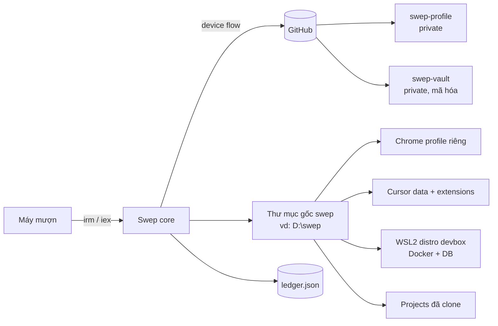
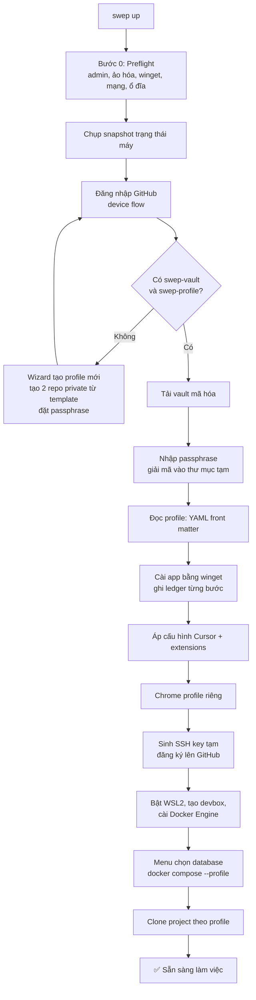
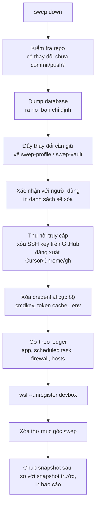

# Swep

> **Một lệnh để biến một máy Windows lạ thành môi trường làm việc của bạn. Một lệnh nữa để trả máy sạch như lúc nhận.**

**Trạng thái:** 🟡 Giai đoạn thiết kế. Chưa có code. Tài liệu này là nguồn sự thật cho giai đoạn 0 (spec), mọi thay đổi thiết kế nên cập nhật ở đây trước khi viết code.

---

## Mục lục

1. [Swep giải quyết vấn đề gì](#1-swep-giải-quyết-vấn-đề-gì)
2. [Mục tiêu và phi mục tiêu](#2-mục-tiêu-và-phi-mục-tiêu)
3. [Trải nghiệm người dùng (dự kiến)](#3-trải-nghiệm-người-dùng-dự-kiến)
4. [Kiến trúc tổng thể](#4-kiến-trúc-tổng-thể)
5. [Luồng `up`](#5-luồng-up)
6. [Luồng `down`](#6-luồng-down)
7. [Repo profile và schema cấu hình](#7-repo-profile-và-schema-cấu-hình)
8. [Vault: lưu trữ bí mật](#8-vault-lưu-trữ-bí-mật)
9. [Ledger và nguyên tắc dọn dẹp](#9-ledger-và-nguyên-tắc-dọn-dẹp)
10. [Docker, WSL2 và database](#10-docker-wsl2-và-database)
11. [Mô hình bảo mật](#11-mô-hình-bảo-mật)
12. [Cấu trúc repo lõi](#12-cấu-trúc-repo-lõi)
13. [Lộ trình theo giai đoạn](#13-lộ-trình-theo-giai-đoạn)
14. [Kiểm thử](#14-kiểm-thử)
15. [Quy ước kỹ thuật](#15-quy-ước-kỹ-thuật)
16. [Rủi ro và câu hỏi còn mở](#16-rủi-ro-và-câu-hỏi-còn-mở)
17. [Đóng góp, giấy phép, miễn trừ trách nhiệm](#17-đóng-góp-giấy-phép-miễn-trừ-trách-nhiệm)

---

## 1. Swep giải quyết vấn đề gì

Bạn phải làm việc trên nhiều máy khác nhau (máy mượn, máy tạm thời). Mỗi lần đổi máy phải:

- Cài lại IDE, công cụ, Docker, database
- Đăng nhập lại Chrome và các dịch vụ
- Clone lại codebase, cấu hình lại mọi thứ
- Và khi xong việc, nhớ dọn sạch mọi thứ để trả máy

**Swep tự động hóa cả hai chiều:** dựng môi trường (`up`) và dọn dẹp (`down`), dựa trên cấu hình cá nhân bạn lưu sẵn.

## 2. Mục tiêu và phi mục tiêu

### Mục tiêu

| # | Mục tiêu | Tiêu chí kiểm tra |
|---|---|---|
| G1 | Một lệnh PowerShell duy nhất để setup | Chạy một dòng lệnh, không thao tác thủ công ngoài đăng nhập và nhập passphrase |
| G2 | Sẵn sàng làm việc trong khoảng 5 phút | Mạng ổn, WSL2 đã bật: ≤ 5 phút. Nếu cần reboot: ≤ 10 phút |
| G3 | Dọn sạch để trả máy | So sánh snapshot trước và sau `down`: không còn app, thư mục, khóa, token do Swep tạo |
| G4 | Không để lộ bí mật | Repo công khai không chứa bí mật; vault mã hóa phía client |
| G5 | Minh bạch | Có chế độ xem trước (`-WhatIf`), mã nguồn mở, kiểm chứng được |
| G6 | Cấu hình linh hoạt | Chọn database, app, project qua cấu hình profile |

### Phi mục tiêu (v1)

- Không hỗ trợ macOS/Linux (chỉ Windows 10/11)
- Không phải trình quản lý mật khẩu (chỉ giữ ít bí mật nhất có thể)
- Không có server trung tâm, không lưu bí mật của người dùng khác
- Không thay thế Docker Desktop, không có GUI quản lý port (để sau)
- Không cam kết "xóa an toàn" ở mức pháp y (xem [mục 11](#11-mô-hình-bảo-mật))

## 3. Trải nghiệm người dùng (dự kiến)

### Cài lần đầu trên máy mới

```powershell
# Luôn chạy theo tag cố định, không chạy theo nhánh main
irm https://raw.githubusercontent.com/<owner>/swep/<tag>/install.ps1 | iex
```

### Các lệnh

| Lệnh | Mô tả |
|---|---|
| `swep up` | Dựng môi trường từ profile của bạn |
| `swep down` | Backup, thu hồi quyền truy cập, dọn sạch |
| `swep status` | Xem đã cài gì, đang chiếm port nào, có thay đổi chưa push |
| `swep doctor` | Kiểm tra máy có đủ điều kiện không (admin, ảo hóa, mạng, ổ đĩa). Không thay đổi gì |
| `swep profile new` | Tạo profile mới (wizard) |
| `swep --WhatIf` | Cờ dùng với mọi lệnh: chỉ in ra việc sẽ làm, không thực hiện |

### Hai điều người dùng phải làm thủ công

1. Xác nhận đăng nhập GitHub trên điện thoại (device flow)
2. Nhập passphrase để giải mã vault

Chrome sẽ cần đăng nhập Google một lần (xem [mục 7](#7-repo-profile-và-schema-cấu-hình)).

## 4. Kiến trúc tổng thể

### Hai lớp repo

| Repo | Ai sở hữu | Hiển thị | Nội dung |
|---|---|---|---|
| `swep` | Cộng đồng | Public | Lõi: script, trình đọc cấu hình, ledger, logic up/down |
| `swep-profile-template` | Cộng đồng | Public | Mẫu profile rỗng để wizard tạo repo cho người dùng |
| `swep-profile` | Từng người | **Private** | Cấu hình cá nhân: IDE, app, database, danh sách project (file markdown + YAML) |
| `swep-vault` | Từng người | **Private** | Một file mã hóa chứa bí mật |

**Nguyên tắc cốt lõi:** Swep không có server của riêng nào. Hạ tầng lưu trữ và xác thực dựa trên tài khoản GitHub mà mọi người dùng đều có. Giao diện lưu trữ (`StorageAdapter`) được thiết kế để sau này cắm thêm adapter khác (S3/R2, Bitwarden, Vercel...), nhưng v1 chỉ có adapter GitHub.

### Sơ đồ thành phần



### Thư mục gốc trên máy

Mọi thứ Swep tạo ra gom vào **một thư mục gốc duy nhất** để dọn một lần:

```
<swep-root>/                  # mặc định D:\swep nếu có ổ D, ngược lại C:\swep
├── state/
│   ├── snapshot.before.json  # trạng thái máy trước khi cài
│   ├── snapshot.after.json   # trạng thái sau khi dọn (để đối chiếu)
│   └── ledger.json           # sổ ghi mọi thay đổi
├── vault/                    # vault đã giải mã (nên nằm trên RAM disk nếu có thể)
├── chrome-profile/           # --user-data-dir của Chrome
├── cursor/
│   ├── user-data/            # --user-data-dir của Cursor
│   └── extensions/           # --extensions-dir của Cursor
├── wsl/                      # ổ ảo (vhdx) của distro devbox
├── projects/                 # code đã clone
└── logs/
```

## 5. Luồng `up`



### Chi tiết từng bước

**Bước 0: Preflight (`swep doctor`)**
- Chạy bằng quyền Administrator? (Nếu không, tự yêu cầu nâng quyền)
- Phiên bản Windows hỗ trợ WSL2? Virtualization có bật không? (Nếu tắt, báo rõ và đề xuất phương án dự phòng, xem [mục 16](#16-rủi-ro-và-câu-hỏi-còn-mở))
- `winget` có sẵn? Có kết nối mạng, đủ dung lượng ổ đĩa?
- Chụp snapshot: danh sách app đã cài, tính năng Windows đang bật, biến môi trường, PATH, scheduled task, distro WSL hiện có

**Đăng nhập GitHub (device flow)**
- Máy hiện một mã, bạn nhập trên điện thoại. Không dán token vào dòng lệnh
- Xin quyền hẹp nhất có thể (tạo/đọc repo private của chính mình, thêm/xóa SSH key)
- Token chỉ giữ trong bộ nhớ của phiên, không ghi ra đĩa

**Giải mã vault**
- Nhập passphrase, giải mã bằng `age` (xem [mục 8](#8-vault-lưu-trữ-bí-mật))
- Nội dung giải mã đặt trong `<swep-root>/vault/`, bị xóa khi `down`

**Cài đặt**
- Mỗi hành động ghi vào ledger **trước và sau** khi thực hiện, kèm cờ `preexisting` (đã có sẵn trên máy trước khi Swep chạy hay chưa)
- Nếu cần reboot (bật WSL2): đăng ký scheduled task `Swep-Resume` để tự chạy tiếp sau khi khởi động lại, đồng thời ghi vào ledger

## 6. Luồng `down`

`down` quan trọng ngang `up`. Thứ tự **cố định**, và dừng lại hỏi ở các bước có rủi ro mất dữ liệu:



**Quy tắc bất di bất dịch:**

1. **Chỉ gỡ những gì có trong ledger với `preexisting: false`.** Máy có sẵn Git thì không bao giờ gỡ Git.
2. **Không làm gì khi chưa xác nhận** nếu còn thay đổi chưa push hoặc chưa dump database.
3. **Thu hồi trước, xóa sau.** Xóa file mà quên thu hồi quyền truy cập thì token vẫn còn hiệu lực.
4. **Tính năng Windows (WSL2, Virtual Machine Platform)** chỉ tắt nếu chính Swep đã bật, và có thể cần reboot.
5. **Báo cáo cuối** liệt kê những gì đã làm, những gì không làm được, và những gì người dùng cần tự kiểm tra.

## 7. Repo profile và schema cấu hình

Repo `swep-profile` chứa các file markdown. Mỗi file có **YAML front matter** (phần máy đọc) và phần văn xuôi bên dưới (người đọc, máy bỏ qua).

> **Vì sao không để máy đọc văn xuôi tự do?** Kết quả cài đặt thật không được phụ thuộc vào cách diễn giải. Phần YAML là hợp đồng, phần văn xuôi chỉ là ghi chú.

### `profile.md` (ví dụ)

```markdown
---
schema: 1
name: my-profile

workspace:
  root: auto              # auto = ổ D nếu có, ngược lại ổ C

apps:
  winget:
    - Git.Git
    - Google.Chrome
    - Anysphere.Cursor
    - OpenJS.NodeJS.LTS

ide:
  name: cursor
  settings: ide/settings.json
  keybindings: ide/keybindings.json
  extensions: ide/extensions.txt      # xuất từ `cursor --list-extensions`

chrome:
  profile_dir: chrome-profile
  sign_in: google                     # đăng nhập Google một lần, Chrome Sync kéo phần còn lại

databases:
  available: [postgres, mysql, redis, mongo, mssql]
  default: [postgres, redis]
  ask_on_up: true                     # hỏi chọn lại mỗi lần up

ports:
  frontend: 5173
  backend: 8080
  postgres: 5432
  redis: 6379

projects:
  - name: my-app
    repo: github.com/<you>/my-app
    path: projects/my-app
---

# Ghi chú cho người đọc

Mô tả tự do về cách bạn làm việc, vì sao chọn các công cụ này...
```

### Excalidraw và Markdown preview

Không cần cài app riêng. Đưa vào `extensions.txt` của Cursor:
- Extension Excalidraw: mở và sửa file `.excalidraw` ngay trong IDE
- Extension Markdown Preview Enhanced: live preview và xuất PDF

Nếu cần dùng bản web (excalidraw.com), nó nằm trong Chrome profile và sync theo tài khoản.

### Chrome: những gì làm được và không làm được

- ❌ **Không** copy thư mục profile Chrome từ máy này sang máy khác: cookie và mật khẩu được mã hóa gắn với user Windows và máy, copy sang sẽ hỏng
- ❌ **Không** lưu cookie đăng nhập vào vault (rủi ro bảo mật lớn)
- ✅ Tạo profile riêng bằng `--user-data-dir=<swep-root>\chrome-profile`
- ✅ Đăng nhập Google một lần; Chrome Sync kéo bookmark, extension, mật khẩu, web app
- ✅ `down` đăng xuất và **xóa hẳn** thư mục profile

"Auto login" thực tế nghĩa là: một lần đăng nhập thủ công, có thể nhanh hơn nếu dùng passkey hoặc trình quản lý mật khẩu.

## 8. Vault: lưu trữ bí mật

### Thiết kế

- Vault là **một file mã hóa** (`vault.age`) trong repo private `swep-vault`
- Mã hóa bằng [`age`](https://github.com/FiloSottile/age) ở chế độ passphrase (scrypt), **mã hóa phía client**: GitHub chỉ giữ bản mã
- Hai lớp bảo vệ độc lập:

| Lớp | Việc nó làm | Nếu bị lộ |
|---|---|---|
| Đăng nhập GitHub (device flow) | Quyết định ai tải được file | Kẻ tấn công lấy được file mã hóa, nhưng chưa đọc được |
| Passphrase | Quyết định ai đọc được nội dung | Cần cả hai thứ mới lộ nội dung |

### Vault nên chứa gì (và không nên chứa gì)

**Nên:**
- Khóa API (AI, dịch vụ khác)
- `.env` của các project
- Cấu hình git (`user.name`, `user.email`)
- **Một** bí mật gốc để mở trình quản lý mật khẩu (nếu bạn dùng), thay vì chép từng mật khẩu vào vault

**Không nên:**
- ❌ Private SSH key chính của bạn. Swep **sinh khóa mới cho mỗi máy** và đăng ký/xóa qua GitHub API
- ❌ Cookie, session Chrome
- ❌ Dữ liệu khách hàng hoặc dữ liệu nhạy cảm không cần thiết

### Quản lý passphrase

- Yêu cầu độ dài tối thiểu và cảnh báo khi quá yếu
- **Mất passphrase là mất vault.** Không có ai reset hộ, vì không có server nào biết khóa. Wizard phải in cảnh báo này và khuyến khích lưu mã khôi phục ở nơi khác
- Lịch sử commit giữ mọi phiên bản cũ của file mã hóa. Nếu passphrase lộ, các bản cũ cũng lộ. Cần có lệnh `swep vault rotate` (đổi passphrase, tùy chọn dọn lịch sử)

### Giao diện adapter (chỗ cắm cho tương lai)

```
StorageAdapter
  authenticate()        -> phiên làm việc
  initialize(profile)   -> tạo kho mới
  pull(name)            -> bytes (bản mã hóa)
  push(name, bytes)     -> ok
  revoke(session)       -> thu hồi phiên
```

v1 chỉ có `GitHubAdapter`.

## 9. Ledger và nguyên tắc dọn dẹp

Ledger là phần **cần test kỹ nhất**: lỗi ở đây có thể gỡ nhầm đồ của chủ máy.

### Định dạng (đề xuất)

```json
{
  "schema": 1,
  "session_id": "2026-10-13T09-12-00Z-a1b2",
  "root": "D:\\swep",
  "snapshot_before": "state/snapshot.before.json",
  "entries": [
    { "type": "winget", "id": "Git.Git", "preexisting": true },
    { "type": "winget", "id": "Anysphere.Cursor", "preexisting": false, "at": "2026-10-13T09:14:02Z" },
    { "type": "windows_feature", "name": "VirtualMachinePlatform", "enabled_by_swep": true },
    { "type": "wsl_distro", "name": "devbox" },
    { "type": "scheduled_task", "name": "Swep-Resume" },
    { "type": "github_ssh_key", "id": 12345678, "title": "swep-DESKTOP-ABC-20261013" },
    { "type": "directory", "path": "D:\\swep" }
  ]
}
```

### Quy tắc ghi ledger

1. Ghi dự định **trước** khi thực hiện, đánh dấu hoàn tất **sau** khi thực hiện (để xử lý trường hợp script chết giữa chừng)
2. Mỗi mục có đủ thông tin để **đảo ngược** (gỡ app theo id, xóa key theo id...)
3. `preexisting` được xác định từ snapshot, không phải từ phán đoán lúc chạy
4. `swep down --WhatIf` in ra đúng danh sách sẽ xóa

### Phần thường bị quên (checklist dọn dẹp)

- Đăng xuất Cursor, `gh auth logout`, xóa SSH key
- Windows Credential Manager (`cmdkey`)
- Biến môi trường, PATH, file `.env`, token cache
- Scheduled task, rule firewall, dòng trong `hosts`
- Danh sách file gần đây (Recent), lịch sử shell
- Profile Chrome
- Tính năng Windows đã bật (nếu cần, reboot)

## 10. Docker, WSL2 và database

### Quyết định

- **Không** cài Docker Desktop (ràng buộc license, nặng, khó dọn)
- Dùng **WSL2 + Docker Engine** trong một distro riêng tên `devbox`
- Dọn dẹp bằng một lệnh: `wsl --unregister devbox`

> "Clone lõi của Docker" không khả thi trên Windows vì Docker engine cần nhân Linux. WSL2 là cách thực tế để có "Docker riêng, không cài chết vào hệ thống".

### Database

- File `docker/compose.yml` dùng **profiles**: mỗi database là một service, chọn cái nào thì chỉ bật cái đó
- Menu chọn lúc `up` (hoặc dùng `default` trong profile)
- Port đọc từ `ports` trong profile; script kiểm tra xung đột port trước khi chạy
- Dữ liệu database nằm trong volume của distro `devbox`, mất khi `unregister`. Muốn giữ thì dump trước (bước của `down`)

```
docker compose --profile postgres --profile redis up -d
```

### Mục tiêu "5 phút" cho phần này

- Kéo trước (pre-pull) các image phổ biến khi mạng tốt
- Nếu WSL2 chưa bật: cần reboot, chấp nhận mục tiêu ≈ 10 phút và nói rõ trong output

## 11. Mô hình bảo mật

Swep chạy với quyền Administrator và đụng đến khóa đăng nhập. Vì vậy bảo mật là yêu cầu hàng đầu.

### Swep bảo vệ trước

| Mối đe dọa | Biện pháp |
|---|---|
| Lộ bí mật qua repo public | Bí mật không nằm trong code; quét secret (gitleaks) trên mọi commit |
| Lộ file vault trên GitHub | Mã hóa phía client bằng `age` + passphrase |
| Quên thu hồi quyền sau khi dùng | `down` thu hồi trước khi xóa; khóa SSH tạm theo máy |
| Bị chèn mã vào lệnh `irm \| iex` | Chạy theo **tag cố định**, kèm checksum; bắt buộc review trước khi merge; có `-WhatIf` |
| Gỡ nhầm đồ của chủ máy | Ledger + cờ `preexisting` từ snapshot |

### Swep **không** bảo vệ trước

- Máy mượn đã nhiễm keylogger hoặc malware: passphrase và mọi thứ bạn gõ có thể bị lấy
- Chủ máy hoặc quản trị viên giám sát hoạt động của bạn
- **Khôi phục dữ liệu sau khi xóa:** xóa file không đồng nghĩa với xóa an toàn. Với dữ liệu thật sự nhạy cảm, hãy đặt code và dữ liệu trên ổ ngoài/ổ đĩa mã hóa mang theo, đừng chỉ dựa vào bước dọn dẹp
- Tài khoản GitHub bị chiếm kèm passphrase yếu

### Nguyên tắc vận hành

- Bí mật chỉ nằm trong bộ nhớ khi có thể; nếu phải ghi file thì nằm trong thư mục gốc để `down` xóa
- Token có phạm vi hẹp và thời hạn ngắn
- Không bao giờ in bí mật ra log
- Cần có `SECURITY.md` với kênh báo lỗ hổng riêng trước khi mở public

## 12. Cấu trúc repo lõi

```
swep/
├── install.ps1                 # bootstrap: kiểm tra, tải bản phát hành, chuyển sang swep.ps1
├── swep.ps1                    # điểm vào các lệnh up/down/status/doctor
├── src/
│   ├── preflight.ps1           # kiểm tra máy, chụp snapshot
│   ├── ledger.ps1              # ghi và đọc ledger
│   ├── auth/
│   │   └── github-device.ps1   # device flow
│   ├── storage/
│   │   ├── adapter.ps1         # giao diện StorageAdapter
│   │   └── github.ps1          # adapter v1
│   ├── vault.ps1               # age encrypt/decrypt, pull/push
│   ├── profile.ps1             # đọc YAML front matter
│   ├── apps.ps1                # winget
│   ├── ide-cursor.ps1          # áp cấu hình + extensions
│   ├── chrome.ps1
│   ├── ssh-key.ps1             # sinh/đăng ký/xóa khóa tạm
│   ├── wsl-docker.ps1          # WSL2 + Docker Engine
│   ├── database.ps1            # menu + compose profiles
│   ├── projects.ps1            # clone project
│   └── teardown.ps1
├── docker/
│   └── compose.yml
├── docs/
│   ├── SPEC.md
│   ├── THREAT-MODEL.md
│   └── LEDGER.md
├── tests/
├── SECURITY.md
├── LICENSE
└── README.md
```

## 13. Lộ trình theo giai đoạn

Mỗi giai đoạn có kết quả kiểm tra được. Chỉ sang giai đoạn tiếp theo khi giai đoạn trước đạt tiêu chí.

### Giai đoạn 0: Spec (hiện tại)

- [ ] Hoàn thiện README này
- [ ] Viết `docs/SPEC.md`: schema YAML chi tiết, định dạng ledger, danh sách lệnh và mã thoát
- [ ] Viết `docs/THREAT-MODEL.md`
- [ ] Quyết định các câu hỏi mở ở [mục 16](#16-rủi-ro-và-câu-hỏi-còn-mở)

**Xong khi:** bạn đọc và đồng ý, chưa có dòng code nào.

### Giai đoạn 1: Khung và Preflight

- [ ] `install.ps1` tải bản theo tag, kiểm tra checksum
- [ ] `swep doctor`: admin, ảo hóa, winget, mạng, ổ đĩa
- [ ] Chụp snapshot, ghi ledger rỗng
- [ ] Hỗ trợ `-WhatIf` ngay từ đầu

**Xong khi:** chạy trên máy ảo cho báo cáo đúng, chưa cài gì thật.

### Giai đoạn 2: Vault và xác thực

- [ ] GitHub device flow
- [ ] Wizard tạo profile (hai repo private từ template)
- [ ] `age` encrypt/decrypt, pull/push vault
- [ ] Kiểm tra độ mạnh passphrase

**Xong khi:** tạo profile trên máy ảo A, sang máy ảo B chạy `up` lấy lại được vault.

### Giai đoạn 3: App, IDE, Chrome

- [ ] Parser YAML front matter
- [ ] Cài app bằng winget, ghi ledger
- [ ] Cursor chạy với `--user-data-dir` và `--extensions-dir` trong thư mục gốc; áp cấu hình và extension
- [ ] Chrome với profile riêng
- [ ] SSH key tạm: sinh, đăng ký, xóa qua API

**Xong khi:** `up` xong là mở Cursor đúng cấu hình, Chrome sẵn sàng đăng nhập.

### Giai đoạn 4: Docker và database

- [ ] Bật WSL2, xử lý reboot và tiếp tục qua scheduled task
- [ ] Tạo distro `devbox`, cài Docker Engine
- [ ] `compose.yml` với profiles, menu chọn database
- [ ] Kiểm tra xung đột port

**Xong khi:** chọn Postgres và Redis thì cả hai chạy đúng port.

### Giai đoạn 5: Down

- [ ] Kiểm tra repo chưa push, dump database
- [ ] Thu hồi SSH key, đăng xuất, xóa credential
- [ ] Gỡ theo ledger, `wsl --unregister`, xóa thư mục gốc
- [ ] So sánh snapshot, in báo cáo

**Xong khi:** máy ảo sau `down` gần như trùng snapshot ban đầu.

### Giai đoạn 6: Gia cố

- [ ] Quét secret trong CI
- [ ] Bản phát hành theo tag + checksum
- [ ] `SECURITY.md`, `THREAT-MODEL.md` hoàn chỉnh
- [ ] Đo thời gian thực tế, cập nhật tuyên bố "5 phút"

**Xong khi:** chạy `up` và `down` 3 lần liên tiếp trên máy ảo sạch, không lỗi.

### Giai đoạn 7: Mở public

- [ ] Rà soát: không còn gì cá nhân trong lõi hoặc lịch sử commit
- [ ] Chọn giấy phép
- [ ] Viết hướng dẫn cho người dùng ngoài

**Xong khi:** một người lạ làm theo README và chạy được.

> **Gợi ý:** giữ repo `private` cho đến hết giai đoạn 6. Việc tách sẵn lõi và profile từ đầu làm bước mở public gần như chỉ là bật công khai.

### Sau v1 (chưa cam kết)

- Trình chạy project: tự nhận diện loại repo (`package.json`, `docker-compose.yml`, `requirements.txt`, `pom.xml`) và chạy; AI dự phòng, **luôn hỏi xác nhận trước khi thực thi**
- Dashboard quản lý port (5173 → FE, 8080 → BE, database...)
- Công cụ truyền file
- Tài khoản Windows tạm (xóa user là xóa gần hết dấu vết)
- Phương án database portable khi không có ảo hóa
- Adapter lưu trữ khác (S3/R2, Bitwarden...)

## 14. Kiểm thử

**Không thử trên máy thật của bạn.**

- Dùng **máy ảo Windows 11 có checkpoint** (Hyper-V hoặc VMware, bật nested virtualization để chạy được WSL2). Quay lại checkpoint sau mỗi lần thử
- Windows Sandbox **không phù hợp**: WSL2 không chạy ổn định bên trong
- Kiểm thử chính của Giai đoạn 5: so sánh `snapshot.before.json` với `snapshot.after.json`
- Kịch bản bắt buộc: máy có sẵn Git và Node (kiểm tra `down` không gỡ nhầm), script chết giữa chừng rồi chạy lại, mất mạng giữa chừng, sai passphrase, WSL2 chưa bật (phải reboot)

## 15. Quy ước kỹ thuật

- **Windows PowerShell 5.1** là mặc định của máy; viết tương thích 5.1, không dùng cú pháp chỉ có ở PowerShell 7
- Script phụ chạy với `-ExecutionPolicy Bypass -Scope Process`
- Mọi lệnh thay đổi hệ thống phải hỗ trợ `-WhatIf`
- Mọi thay đổi phải ghi ledger trước khi thực hiện
- Không in bí mật ra log; log nằm trong `<swep-root>/logs` và bị xóa khi `down`
- Ghim phiên bản mọi thứ tải về (tag, checksum)
- Mã thoát rõ ràng: `0` thành công, khác `0` kèm thông báo hướng dẫn

## 16. Rủi ro và câu hỏi còn mở

### Rủi ro

| Rủi ro | Mức | Hướng xử lý |
|---|---|---|
| Ảo hóa bị tắt trong BIOS của máy mượn | Cao | Báo rõ trong `doctor`; cân nhắc phương án database portable |
| Chuỗi cung ứng qua `irm \| iex` | Cao | Tag cố định, checksum, review, `-WhatIf` |
| Ledger sai làm gỡ nhầm đồ chủ máy | Cao | Cờ `preexisting` từ snapshot, test kỹ, xác nhận trước khi xóa |
| Cần reboot làm vỡ mục tiêu 5 phút | Trung bình | Scheduled task tiếp tục; nói rõ thời gian thực tế |
| Mạng chậm | Trung bình | Pre-pull image; hiển thị tiến trình |
| Mất passphrase | Trung bình | Cảnh báo khi tạo; mã khôi phục |
| GitHub sập hoặc khóa tài khoản | Thấp | Chấp nhận trong v1; adapter khác về sau |

### Câu hỏi còn mở (cần quyết định trong Giai đoạn 0)

1. **Thu hồi token GitHub:** thu hồi token OAuth bằng API cần `client_secret`, mà ứng dụng mã nguồn mở không giấu được secret. Cần xác minh giải pháp: dùng GitHub App với token người dùng có hạn ngắn (tự hết hạn), hoặc hướng dẫn thu hồi thủ công trong cài đặt GitHub.
2. **Ảo hóa tắt:** có làm phương án database portable (Postgres/MySQL/Redis dạng zip) ngay v1 hay để sau?
3. **Ổ đĩa:** thư mục gốc nằm trên ổ máy mượn hay ổ ngoài mang theo? Ảnh hưởng mặc định của `workspace.root`, cách backup và mức an toàn khi trả máy.
4. **Tài khoản Windows tạm** có đưa vào v1 hay chỉ là tùy chọn nâng cao?
5. **Mã định danh winget** của từng app (đặc biệt Cursor) cần xác minh bằng `winget search` trước khi ghi vào template.
6. **Cursor với `--user-data-dir` và `--extensions-dir`:** cần thử xác nhận hoạt động đúng như kỳ vọng (cơ chế tương tự VS Code).
7. **Giấy phép:** MIT hay Apache-2.0?

## 17. Đóng góp, giấy phép, miễn trừ trách nhiệm

- Giấy phép: sẽ chọn trước khi mở public (xem câu hỏi mở)
- Đóng góp: mọi thay đổi vào lõi phải qua review; không chấp nhận mã chạm vào bí mật nếu chưa có mô hình đe dọa cập nhật
- Báo lỗ hổng bảo mật: xem `SECURITY.md` (sẽ bổ sung ở Giai đoạn 6), **không** mở issue công khai

> ⚠️ **Miễn trừ trách nhiệm:** Swep cài phần mềm, thay đổi cấu hình hệ thống và xóa dữ liệu. Chỉ dùng trên máy bạn được phép thay đổi, luôn chạy `-WhatIf` trước khi chạy thật, và đọc kỹ báo cáo của `swep down`. Tác giả không chịu trách nhiệm về mất mát dữ liệu hay hư hỏng phát sinh khi sử dụng.