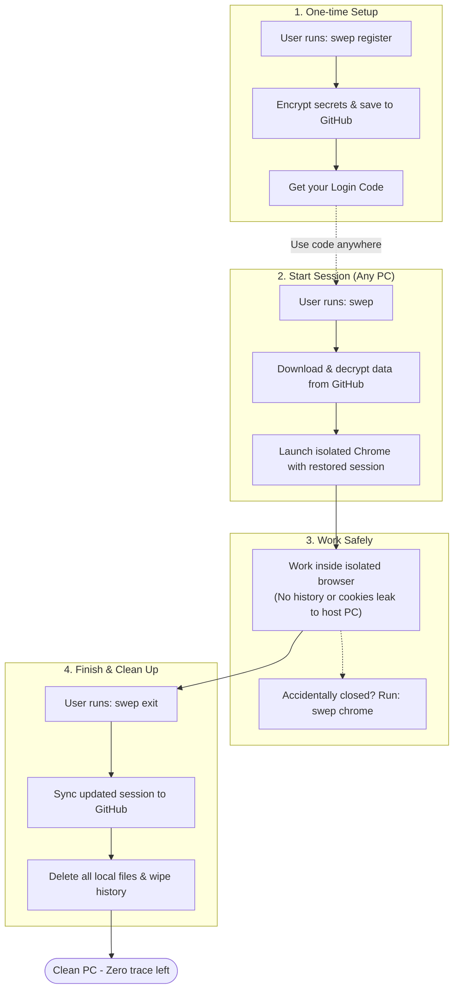

# Swep - Simplified User Flow

A clean, easy-to-understand diagram showing how Swep works. You can copy the code block below directly into [Excalidraw](https://excalidraw.com) via **More tools > Mermaid to Excalidraw**.

---

## Simple Mermaid Flowchart

---

## How to Import into Excalidraw
1. Go to [excalidraw.com](https://excalidraw.com).
2. Click **More tools** (top bar).
3. Choose **Mermaid to Excalidraw**.
4. Paste the code above and click **Insert**.
