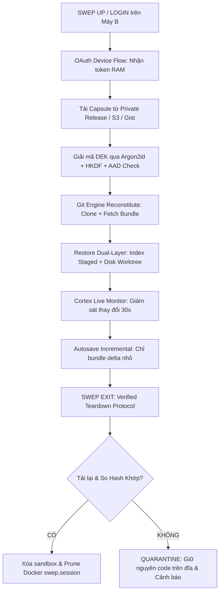

# SWEP Architecture & Next Session Roadmap

> **Phiên bản hiện tại**: `0.1.14`  
> **Cập nhật lần cuối**: `2026-10-15`  
> **Trạng thái kiểm thử**: `41/41 tests passing` (Bao gồm Property-Based Randomized Testing & ESLint 0 warning)

---

## I. TỔNG KẾT NHỮNG GÌ ĐÃ TRIỂN KHAI TRONG PHIÊN NÀY

### 1. Dual-Layer Git State Reconstruction Engine (`src/cortex/git_engine.js`)
* **Atomic Index Freeze (Chụp nguyên tử trong 1 lần đọc)**:
  * Lấy đường dẫn index qua `git rev-parse --git-path index` (tương thích cả Git Worktree và Submodule).
  * Sao chép index sang file tạm `tempIndexPath` ngay tại thời điểm bắt đầu.
  * Cả `stagedTree` và `worktreeTree` đều được sinh ra từ snapshot này, loại bỏ 100% race-condition nếu lập trình viên đang chỉnh sửa hoặc `git add` trong lúc snapshot.
* **Zero Mutation trên `.git/objects`**:
  * Chuyển hướng ghi đối tượng bằng `GIT_OBJECT_DIRECTORY=<temp_obj_dir>` kết hợp `GIT_ALTERNATE_OBJECT_DIRECTORIES=<real_obj_dir>`.
  * Không để lại bất kỳ loose object nào trong thư mục `.git/objects` của người dùng. Ngăn chặn triệt để việc làm bẩn repo và kích hoạt `git gc --auto`.
* **Thứ tự nạp Index vs Disk chuẩn xác**:
  1. Nạp `worktreeTree` vào đĩa qua index tạm độc lập: `GIT_INDEX_FILE=restoreIndex git read-tree` + `git checkout-index -a -f`.
  2. Quét và xóa an toàn các file đã xóa hoặc đổi tên khỏi `currentHead` (có kiểm tra chống Path Traversal).
  3. Nạp `stagedTree` vào index thật của repo: `git read-tree <stagedTree>`.
  4. Đảm bảo trạng thái `git status --porcelain=v2` và `git ls-files -s` trên Máy B khớp 100% từng byte với Máy A.
* **Hỗ trợ đầy đủ các ca biên của Git**:
  * Nhánh chưa có upstream: Tự động tìm commit nền gần nhất bằng `git merge-base HEAD <remotes>`.
  * Detached HEAD: Chuyển sang `git checkout --detach <head>`.
  * Trùng tên nhánh mặc định: Dùng `git checkout -B <branch>` để reset/tạo mới an toàn.
  * Tự động dọn sạch các ref tạm (`refs/swep/*`) sau khi tạo và giải nén bundle.
* **Pre-flight Chống Mất Dữ Liệu**:
  * Phát hiện `MERGE_HEAD`, `rebase-merge`, `rebase-apply`, `CHERRY_PICK_HEAD`, `REVERT_HEAD`, `BISECT_LOG`.
  * Không chặn thô bạo (không ném lỗi làm mất code): Gắn cờ `meta.inProgressState` và đưa file quá cỡ (> 50MB) vào `meta.skippedLargeFiles` để phiên làm việc vẫn được snapshot an toàn.

### 2. Quy Tắc Xóa An Toàn & Crash Janitor Cách Ly (`src/cleanup.js`)
* **Biên lai Upload (`upload.receipt.json`)**:
  * Chỉ cho phép xóa thư mục session khi có biên lai upload được xác minh kèm mã băm SHA-256.
* **Kiểm tra tiến trình sống bằng PID + Process Creation Time**:
  * Hàm `isProcessAliveWithCreationTime(pid, creationTime)` kết hợp PID và `CreationDate` từ CIM `Win32_Process` để loại trừ hoàn toàn trường hợp Windows tái sử dụng PID cho tiến trình khác.
* **Crash Janitor Quarantine**:
  * Quét các session mồ côi khi SWEP khởi động.
  * Nếu session đã có receipt xác minh: Xóa an toàn.
  * Nếu session CHƯA có receipt xác minh (máy sập trước/trong khi upload): **Tuyệt đối không xóa**, chuyển toàn bộ vào `%LOCALAPPDATA%\Swep\quarantine\<session_id>` để bảo toàn code cho người dùng.

### 3. Credential Cô Lập
* Hàm `createIsolatedGitCredentials(token)`:
  * Tạo script `GIT_ASKPASS` tạm thời trong bộ nhớ.
  * Truyền cờ `-c credential.helper=` để vô hiệu hóa Git Credential Manager của Windows.
  * Token không bao giờ bị ghi vào `.git/config` hay Credential Store của hệ điều hành máy mượn.

### 4. Kiểm Thử Định Lượng & Property-Based Testing
* [tests/git_engine.test.js](file:///d:/swep/tests/git_engine.test.js):
  * Kiểm chứng Zero Mutation trên `.git/objects` (đếm số object trước/sau).
  * Đối chiếu `git ls-files -s` (mode, hash, stage, file) giữa Máy A và B.
  * Đối chiếu SHA-256 từng file trên đĩa giữa Máy A và B.
* [tests/git_engine_property.test.js](file:///d:/swep/tests/git_engine_property.test.js):
  * Áp dụng chuỗi 15 thao tác ngẫu nhiên (sửa staged, sửa unstaged, xóa staged, xóa unstaged, git mv, binary, commit chưa push, untracked).
  * Khẳng định tính toàn vẹn 100% của trạng thái tái tạo.
* [tests/cleanup_janitor.test.js](file:///d:/swep/tests/cleanup_janitor.test.js):
  * Kiểm tra quy trình cấp biên lai, cách ly quarantine khi chưa upload, và môi trường askpass.

---

## II. KẾT QUẢ SPIKE & CÁC KẾT LUẬN KIẾN TRÚC ĐÃ CHỐT

### 1. Transport & CAS trên GitHub Gist
* **Custom Ref**: GitHub Gist **từ chối** các ref tùy biến dạng `refs/swep/*`. Gist chỉ chấp nhận push vào `refs/heads/main` (hoặc `master`).
* **CAS (Compare-And-Swap)**: Push vào nhánh `main` của Gist có kiểm tra fast-forward. Nếu có xung đột từ máy khác, server sẽ trả về `[rejected - non-fast-forward]`.
* **Giới hạn 100MB của Gist**:
  * Ciphertext có entropy cao nên Git không thể tính delta nén giữa các commit.
  * Mỗi lần autosave 1MB $\rightarrow$ packfile tăng 1MB.
  * Sau ~100 lần autosave, Gist sẽ chạm trần **100MB** và bị GitHub khóa lệnh push (`fatal: pack exceeds maximum allowed size`).
* **Quyết định**: Gist chỉ phù hợp cho snapshot cuối phiên hoặc các delta cực nhỏ (vài KB). Phiên bản tương lai sẽ chuyển kho dữ liệu lớn sang **Private GitHub Repo Release Assets** hoặc **S3-compatible Object Storage**.

### 2. Vòng Đời Khóa & Threat Model
* **Kịch bản 1: Lộ chuỗi mã đầy đủ (`handle-gistId-rawCode`)**:
  * Kẻ tấn công có cả URL và khóa. Phá vỡ trong 0 giây.
  * *Ứng phó*: Bắt buộc **Full Re-Keying** (Sinh DEK mới, xóa vĩnh viễn Gist cũ bằng API, đẩy sang Gist ID mới). Re-wrap giữ nguyên DEK là vô dụng vì commit cũ trong Gist vẫn chứa `wrapped_dek` cũ.
* **Kịch bản 2: Lộ URL Gist nhưng không lộ rawCode**:
  * Vét cạn qua Argon2id (`memoryCost: 65536`, `timeCost: 3`, `parallelism: 4`).
  * Mã 6 ký tự: ~15 giờ (cụm 100 GPU) $\rightarrow$ Chi phí < $20 $\rightarrow$ Không an toàn.
  * Mã 10 ký tự: ~1.780 năm (kỳ vọng 50% không gian) $\rightarrow$ Chi phí > $30.000.000 $\rightarrow$ An toàn kinh tế.
* **Cấu trúc AAD**:
  $$\text{AAD} = \text{SHA256}(\text{capsuleId} \parallel \text{revision} \parallel \text{parentHash} \parallel \text{deviceId})$$
  Chống tấn công tráo đổi hoặc hạ cấp revision của capsule.

### 3. Cookie Trình Duyệt: Tách Riêng & Mặc Định OPT-IN
* Mặc định: **Không đồng bộ cookie phiên**. Chỉ sync Tab URLs, cấu hình dự án, Git state và `.env`.
* Tùy chọn `--sync-cookies`: Chỉ bật khi user chủ động yêu cầu, có cảnh báo nguy cơ bị khóa tài khoản (do anti-fraud cơ chế IP/thiết bị của Google, GitHub, Jira).

### 4. Khôi Phục Runtime: An Toàn Tuyệt Đối (Chống RCE)
* Không dùng chuỗi lệnh shell (`exec`).
* Dùng mảng có cấu trúc: `argv: ["npm", "run", "dev"]` thực thi qua `spawn(argv[0], argv.slice(1), { shell: false })`.
* Allowlist runner: Chỉ cho phép `npm`, `pnpm`, `yarn`, `cargo`, `go`, `docker`.
* Bắt buộc có hộp thoại xác nhận rõ ràng trước khi chạy.

---

## III. ROADMAP CHO PHIÊN LÀM VIỆC TIẾP THEO

### Mục tiêu phiên tiếp theo:
> **Ghép nối toàn diện Git Engine vào quy trình `swep login` / `swep down` / `swep checkout` và triển khai giải pháp lưu trữ Capsule vượt qua giới hạn 100MB của Gist.**



### Chi tiết các công việc cần làm:

#### 1. Đóng gói Capsule Format V2 (`src/vault.js`)
* **Tại sao**: Format V1 lưu monolithic base64 trong Gist, không hỗ trợ AAD và không tách biệt giữa Git bundle và file cấu hình.
* **Làm thế nào**:
  * Định dạng Capsule V2:
    ```json
    {
      "version": 2,
      "capsuleId": "cap_xyz123",
      "revision": 1,
      "parentHash": null,
      "deviceId": "machine_a",
      "timestamp": "2026-10-15T...",
      "aad": "<hex_string>",
      "gitMeta": { ... },
      "bundlePayloadEnc": "<base64>",
      "configsEnc": "<base64>",
      "authPayloadEnc": "<base64>"
    }
    ```
  * Áp dụng AAD vào ChaCha20-Poly1305.

#### 2. Tích hợp Git Engine vào `swep login` và `swep down`
* **Tại sao**: Hiện tại `login` và `down` mới chỉ xử lý Chrome profile. Cần tự động snapshot Git khi kết thúc phiên và hydrate Git khi bắt đầu phiên trên máy mới.
* **Làm thế nào**:
  * Khi `swep <codeOrKey>` chạy:
    1. Clone repo từ remote HTTPS sử dụng token `GIT_ASKPASS`.
    2. Giải nén bundle và chạy `reconstituteGitState`.
    3. Hiển thị prompt xác nhận mở IDE (Cursor / VS Code) trong sandbox độc lập `--user-data-dir`.
  * Khi `swep exit` hoặc `swep down`:
    1. Chạy `captureGitStateBundle`.
    2. Mã hóa capsule V2.
    3. Đẩy lên vault remote.
    4. Tải lại metadata và so khớp SHA-256.
    5. Ghi `upload.receipt.json`.
    6. Dọn dẹp an toàn các tiến trình và file tạm.

#### 3. Chuyển đổi phương thức lưu trữ Capsule (Thoát khỏi giới hạn Gist 100MB)
* **Vấn đề chưa giải quyết**: Gist repo bị chặn khi đạt 100MB packfile.
* **Giải pháp triển khai**:
  * Hỗ trợ lưu trữ Capsule dưới dạng **Asset trên GitHub Release của Private Repo `swep-vault`** (hỗ trợ file lên đến 2GB mỗi release, không bị tính vào Git packfile history).
  * Hỗ trợ S3 / Cloudflare R2 presigned URLs nếu người dùng muốn tự host storage.

#### 4. GitHub App Device Flow & Org SAML
* Đăng ký GitHub App chính thức cho SWEP (`SWEP Workspace Sync`).
* Cấp quyền hạn hẹp: `Contents: Read & Write` chỉ trên các repo mà người dùng cấp phép, tránh đòi quyền toàn cục `repo` như OAuth App.
* Quản lý refresh token trong bộ nhớ tạm của phiên làm việc.

---

## IV. MỤC TIÊU CUỐI CÙNG (NORTH STAR)

SWEP sẽ trở thành một **Zero-Trust Workspace Roaming Engine**:
1. **Không phụ thuộc đám mây trung gian**: Không cần máy chủ backend trung gian (Zero-Server Architecture), mã hóa đầu cuối phía client.
2. **Không để lại dấu vết trên máy mượn (True Zero Host Mutation)**: Không sửa đổi cấu hình toàn cục, không ghi token vào đĩa, không can thiệp vào tài khoản của chủ máy.
3. **Không bao giờ làm mất code của người dùng**: Bảo toàn 100% commit chưa push, thay đổi staged/unstaged, nhánh làm dở; chỉ dọn dẹp khi đã có biên lai xác minh toàn vẹn mật mã; tự động cách ly an toàn khi có sự cố bất ngờ.
